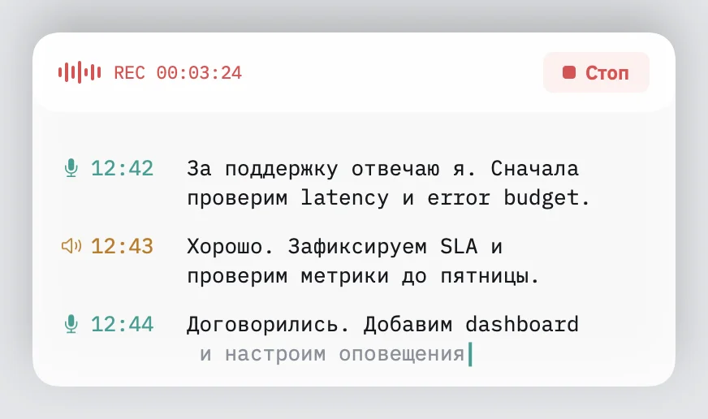
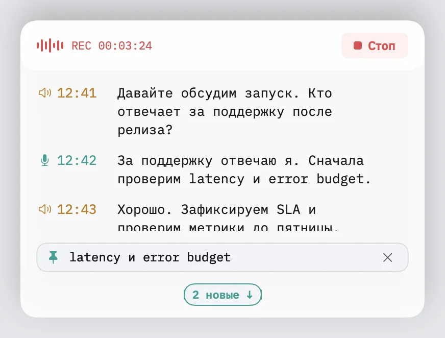

# Audelin: Reading While the Words Arrive

A live transcript has two readers to serve: the person following the conversation now, and the same person looking back at something said a minute ago. Those needs stop agreeing as soon as the person scrolls up or selects a phrase.

[Audelin](https://github.com/igor1309/audelin) is a native macOS app that records both sides of a call and transcribes them locally. Its floating panel stays beside the call window. The recent work on that panel was about letting someone read while the recogniser keeps writing.

## Who said it, and whose words are missing?

The earlier gutter labelled speakers with the Russian words «я» and «они». It now uses a microphone for my side and a speaker for the other side, each in its own colour. The timestamp uses the same colour. Wrapped lines begin under the text, leaving the speaker and time in a separate gutter.

Gap captions carry the missing side's symbol too. A warning about missing audio should tell me which half of the conversation it concerns, rather than making the whole transcript look suspect.

Here is the panel following the newest words. The screenshots use synthetic Russian conversation text with English terms, rendered by the actual panel; they contain no recorded call.

## Selection has to work without focus

The panel does not become the active window. That is useful during a call, but it also means macOS draws a selection with its inactive appearance. Setting a selection background alone can leave the letters hard to read.

The text view now uses the system's matching inactive foreground and background colours. A drag selection remains legible in light and dark appearances. Selecting across entries leaves speaker symbols and timestamps out of the held text: the passage is what matters.

A held passage appears in a compact card with up to three lines. Hovering reveals its full text. This gives the phrase somewhere to stay while new words arrive below.

The second screenshot shows the same synthetic conversation after holding “latency и error budget” and pausing live following. These are two reading states of the current panel, rather than captures of old and new app versions.

## Let the reader keep their place

Following live text and reading history are different modes. While following, later layout growth still needs to bring the newest line into view. While reading back or dragging a selection, it must leave the reader alone. A new-entry indicator offers a way back to the live end.

Keeping the scroll offset was only part of that work. Measuring the text could move the text layout system's viewport even without changing the scroll position. Empty text edits could disturb selection too. The panel avoids unnecessary edits and viewport-changing measurement during paused updates.

Resizing reflows the existing text. It should not append another copy of the conversation or lose words at the new width. The [text-view tests](https://github.com/igor1309/audelin/blob/main/macos/Tests/PanelUITests/TranscriptLogTests.swift) cover resize preservation and reading behaviour alongside the gutter and selection rules.

Sometimes the useful panel is a hidden one. A menu option hides and restores it while recording and transcription continue.

The [previous post](https://igor1309.dev/articles/2026/2026-11-07-audelin-a-millisecond-to-update-the-transcript/) covered making updates cheaper. This work asks what those updates are allowed to move. The code and build instructions are in [Audelin's public repository](https://github.com/igor1309/audelin).
