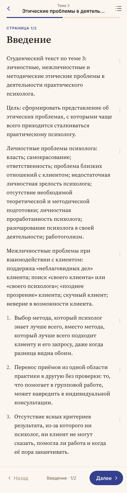
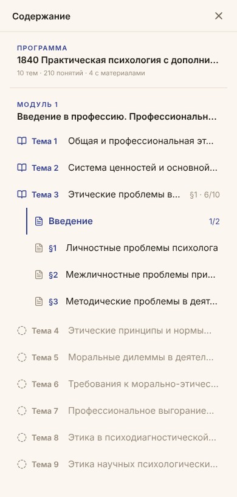

# Agonara Session: Reading a Lecture on a Phone

[Agonara](https://github.com/igor1309/agonara) holds a learning program: topics, concepts, materials and checks. A student is meant to read it. In practice that means a phone, on a sofa or a train, and one of the real lectures is almost 16,000 characters long.

Agonara Session is a small runner that sits between the student and Agonara. It reads the programs the student can see through Agonara's public API, as that student, and draws them somewhere a phone can reach. It holds no learning truth of its own and writes nothing to Agonara yet. This post is about getting one lecture to read well on a phone, which took more rounds than expected.

## Telegram first

The first surface was a Telegram bot, because it needs no app, no public URL (it uses long polling) and already lives on the phone. It answers one chat only, and every button carries the step it was drawn for, so pressing an old message is refused instead of acting on a newer state.

Browsing came first: programs, a program's topics, concepts and materials, then a material's text with its front matter left out. On an iPhone it was unreadable. Long titles became cut-off full-width buttons, a program produced 23 buttons in a column, and a lecture arrived as a wall of raw markdown.

The fix was to stop treating buttons as the list. Names went into the message as numbered lists under bold headings, the buttons became number keys five to a row, the markdown became Telegram HTML, and a press edited its own message instead of sending a new one.

Then Telegram's rich messages (Bot API 10.1) made the names tappable where they are written. Each screen became one rich message, with Back, Programs, Prev and Next as button rows at the end. If Telegram refuses a rich message, the bot sends the older HTML-and-number-keys screen and logs the refusal, so the student always gets something.

One design decision made all of this cheap to change: the session returns a screen as meaning — a title, lists, a position, actions by kind — and the Telegram adapter decides how to draw it. Every round above touched only the drawing.

## Paging by screen, not by section

Rich messages can hold a long text with collapsed sections, so the next attempt put the whole lecture in one message with each lower heading folded. Opening or closing a section moved the chat, and the reader lost their place.

Cutting the lecture at its top-level sections was better, but a section is still taller than a phone. After each tap Telegram showed the end of the new message, not its start.

What worked was paging by screen. A page is about 1,000 characters, cut at a paragraph and never across a section. A page that fits the screen is flipped in place by Next, so nothing scrolls. Each page starts with where it is (*§2 Section · 3/6*) and ends with Prev, Next and Contents. The contents page lists the intro and each section; its button back to the text was first labelled "◀ Text", which read as "go back somewhere", so it became "📖 Continue reading".

The 16,000-character lecture is now 23 pages. It is more taps, and much easier to read.

## Moving to a web page

A chat can only go so far: little control over typography, no room for a menu on a paragraph. So the same session got a second surface, a web page served on the local network.

It was designed before it was built, in [pen.dev](https://pen.dev), from real program data rather than placeholder text: tokens for colour, type, spacing and radius, components, and iPhone, iPad and desktop screens in light and dark. A second round raised dark-mode contrast and added a second palette, so there are two: Ink & Saffron, used by default, and Pine & Lichen. The page's CSS is generated from the design's colour variables, so the palettes do not drift from the design.

  
  

The page cuts a lecture exactly as the bot does, because both draw the same screens. The outline is a sidebar on a wide screen, a drawer on a medium one and a sheet on a phone. Every paragraph has a ⋯ menu — Tell me more, Explain simpler, Give an example, Ask a question — whose answers are a stub until a model is chosen. Addresses are real (`/p/{program}`, `/m/{entity}?page=N`), so Back, refresh and links work, and the last page read is kept for Continue reading. Access needs a token once; the page trades it for a cookie.

## Deploy on merge, without a server

Along the way the bot was ported to Go: one module, no dependencies, two commands — the bot and the web page — run by launchd on a Mac.

Deploying is a git `post-merge` hook. When trunk moves in the local clone and the session's code changed (docs, design and markdown don't count), the hook runs the tests, builds both commands, keeps each old binary as `.prev`, swaps in the new one and restarts its LaunchAgent. If the tests or a build fail, the old bot and page keep running, and the merge itself never fails. Merging on GitHub alone does nothing; the deploy happens when the Mac's clone fast-forwards.

It is the right size for one student and one Mac: no server, no pipeline, a log file to read, and the previous binary one `mv` away. The Mac runs it only while it is awake, and a hosted server waits until that matters.

Next comes the part the ⋯ menu is waiting for: what the session answers when the student asks.
