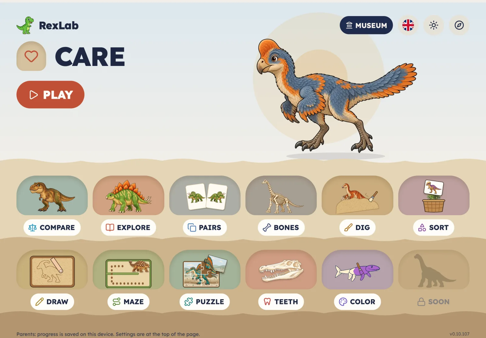
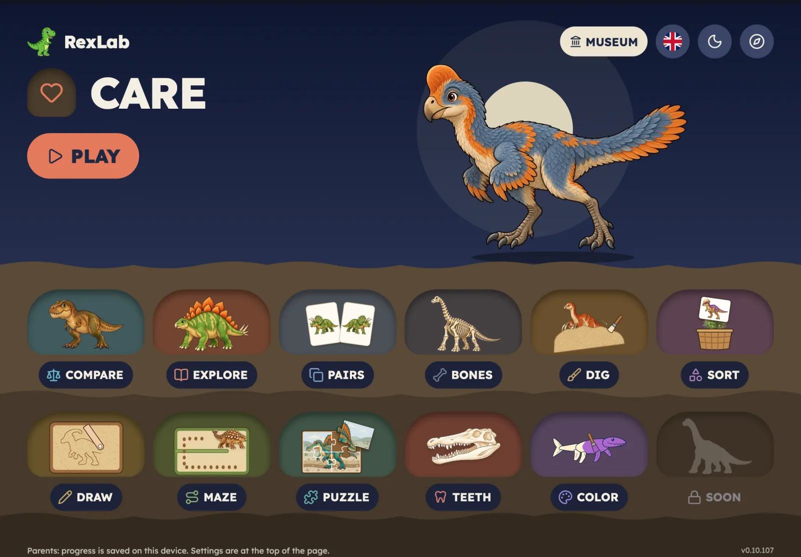

# RexLab: The Dig Site

[RexLab](https://rexlab.enoa.ai) grew one game at a time: digging up fossils, matching jaws, comparing sizes, finding pairs, caring for visiting dinosaurs, colouring, a labyrinth, a skeleton museum. Each game was built when it was needed and got whatever look fitted it then. Each one was fine. Put together, they felt like eight apps.

This week every one of them moved onto the same piece of ground.

## One world instead of eight looks

The idea is a dig site. The sky at the top holds titles, the score and the buttons a parent might need. Below it, sand, then ochre earth, then bedrock. Things a child plays with sit in the ground: answer cards are sand pockets, the maze is tunnels in the earth, skeletons stand on plinths on the sand.

Home shows this best. Today's game sits in the sky with a big PLAY. Every other game is a pocket further down, and one scroll takes you from sky to bedrock. Each tile shows its game *being played*, with that game's own creature and colour: a jaw for WHOSE JAW?, a matched pair of cards for FIND THE PAIR. A four-year-old who can't read the titles can still tell the games apart.

## Design first

Nothing was restyled in code first. Every screen was drawn in [pen.dev](https://pen.dev) as a set of frames: each game's welcome, board and result, in light and dark, English and Russian, for every age level.

Then came a review of every screen group, each approved on its own. It found small things a test would never catch: a Russian badge out of place, an iPad title that didn't fit, a turn-sideways arrow drawn twice. After that, every colour, font size, corner radius and gap in the frames was replaced by a named design token, and the code reads the same tokens. A palette change is now made in one place.

## The gate

The rule for any visual change is written down, and it is short: post screenshots from the running app for every age level and every window size it touches, then stop. No merge, no release, until the owner approves.

That rule comes from experience. A colouring drawing once passed every test and was still, in the owner's words, "terrible even for a 4-year-old". Passing tests say nothing about whether art looks good. Rejected art is redrawn and stops at the gate again.

With agents doing much of the building, the gate also means a run cannot call a screen finished. It finishes when a person has looked at it.

## One game at a time

Each game moved in its own change: DIG, then WHOSE JAW?, COMPARE, FIND THE PAIR, FRIENDS, Colouring, LABYRINTH and finally the BONES skeleton museum. Each change touched only presentation; the rules, scores, saving and navigation stayed the same, and the existing tests showed it. Where matching a board exactly would have broken a layout test that guards a small screen, the test won and the difference was written down.

The biggest single piece is the Home hero for the skeleton game: a pile of bones that assembles into a standing T. rex, pauses and turns once. It loads only when visible, and with reduced motion on it simply shows the finished skeleton. Its first version was approved, then reworked to be livelier: bones leave the pile at a steady pace, three stragglers hop in last, and everything lands before the turn.

## Small screens

A design drawn for an iPad landscape breaks first on a phone held upright. So the frames cover every window shape: iPad landscape and upright, iPhone on its side and upright, down to the iPhone SE at 375 by 667.

The labyrinth showed why. Screenshots of an upright iPhone revealed a short maze strip panning far sideways over a large empty area. Now every maze turns on its side on an upright phone and fills the height. On the SE, the smallest maze needed more: the parent dinosaur moves from a row under the maze onto its home square, the side padding narrows, and the whole 7 by 9 maze fits at full cell size without panning. A layout test now requires it, across 504 combinations of window, level and language.

## What the process caught

Most of what the design-first process found was small: misplaced labels, titles that didn't fit, an empty corner on a phone. None of it would have failed a test, and all of it would have been noticed by a child, or at least by a parent watching.

The cost is speed. A screen waits for a person to look at it. The payoff is that RexLab now looks like one place, and stays that way as games are added.

Play it at [rexlab.enoa.ai](https://rexlab.enoa.ai); the code is at [github.com/igor1309/rexlab](https://github.com/igor1309/rexlab).
