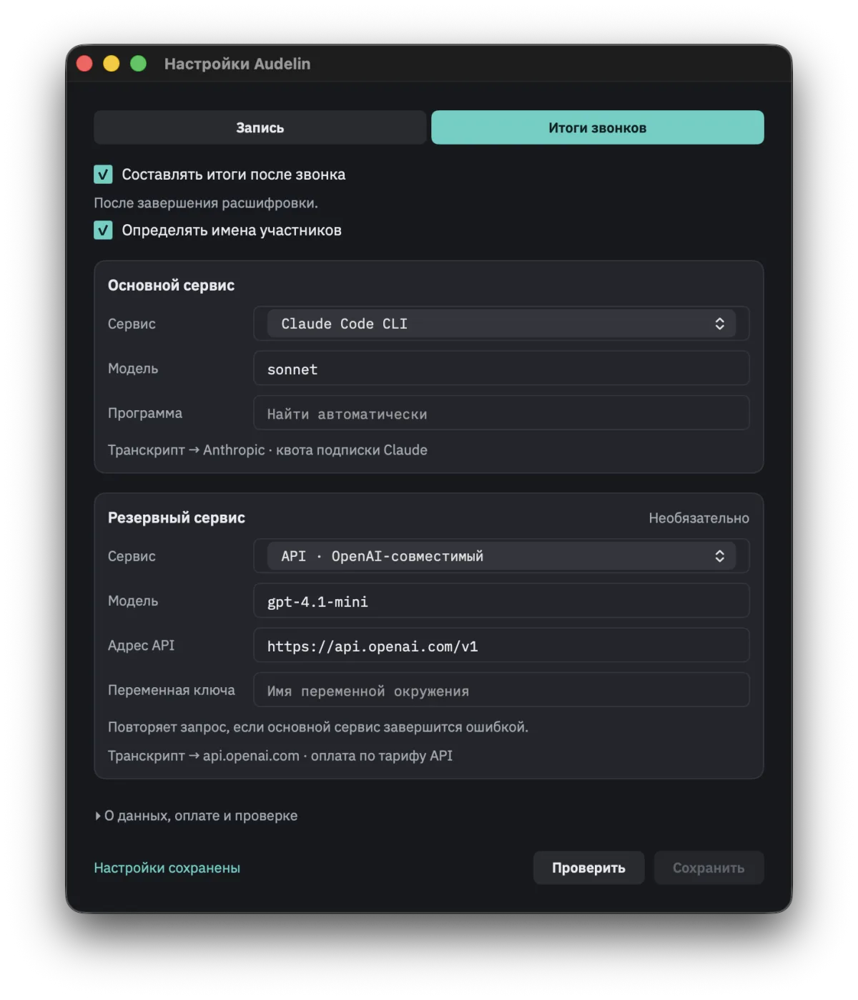

# Audelin: Where the Transcript Goes

A settings window can explain an architecture better than a diagram. This one has a primary service, an optional fallback, and two short lines that matter more than the model names: where the transcript goes and how the request is paid for.

[Audelin](https://github.com/igor1309/audelin) records both sides of a call and produces a live transcript on the Mac. Audio capture and speech recognition run locally. Adding a summary after the call introduces a different decision: which service gets to read those words?

The screenshot below shows the call-summary settings I am working on. It is a look at the design, rather than a walkthrough of a released feature. The public app's recording and transcription are the starting point; this screen explores what comes next.

## Local needs a boundary

“Local” is straightforward while the audio and recogniser stay on the computer. A cloud summary changes that boundary even if the recording never leaves the disk. The transcript is still the conversation, including the parts someone might reasonably expect to remain private.

That is why the primary service card says “Transcript → Anthropic” beside its subscription label. The fallback card names its API destination and separate API billing. These details belong beside the controls that select the service, where a person can see them before saving.

The screen separates recording from call summaries with two tabs. That separation helps explain that capturing a conversation and sending its text for interpretation are different choices.

## A CLI is another route to a service

The primary card in this example selects Claude Code CLI and a model. The alternative card selects an API-compatible service, with fields for the model, endpoint and credential variable.

The interesting part is the route, more than the particular model. Launching a program on the Mac can still result in a cloud request. A local executable does not make its model local, and a subscription label does not establish unlimited use or permission for every integration.

This screen describes the intended payment route. It does not establish provider support, available quota, or the quality of the resulting notes. Those need their own checks before an integration can be presented as dependable.

## Fallback changes more than reliability

The fallback is marked optional. Its explanatory text says it repeats a request when the primary service fails. That sounds like a small convenience until the second destination has a separate bill and receives the same conversation.

I want that consequence visible in the configuration itself. Choosing a backup should mean knowingly choosing another recipient, rather than merely asking for fewer errors.

There is also work beyond this screen: deciding which failures permit a retry, making the service actually used visible, and distinguishing a failed request from a summary that completed with uncertain content. A settings screenshot cannot demonstrate any of those behaviours.

What it can do is put the right questions in front of the person making the choice. Before asking whether the summary is useful, they should be able to answer where the transcript will go and what happens if that route fails.

The recording and live-transcript code, screenshots and build instructions are in [Audelin's public repository](https://github.com/igor1309/audelin).
