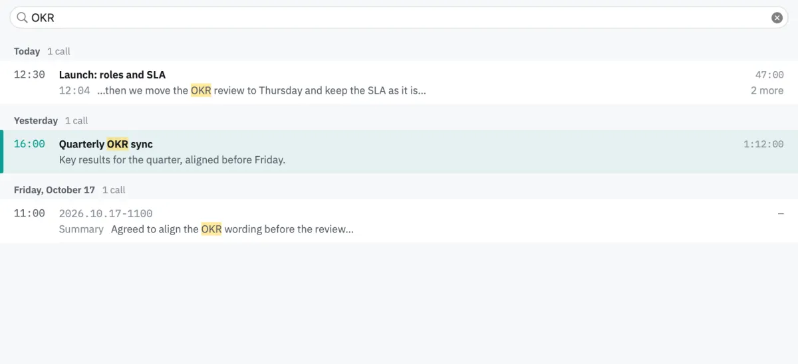
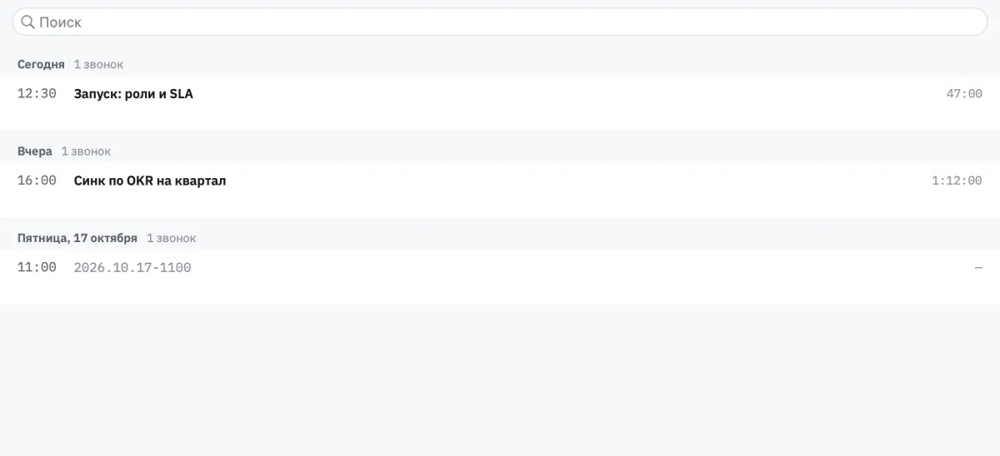

# Audelin: Design First, Then the Calls Window

[Audelin](https://github.com/igor1309/audelin) records both sides of a call and transcribes them on the Mac. Every call ends up in one window, the calls list, and this week that window was redrawn from the ground up. The order of work was the point: draw every state first, pick one, then build it and pin it with images.

## What was wrong with the old list

The old window was a list of calls. To read a call's notes you clicked an eye on its row, pressed Space, or chose «Показать итоги», and the notes opened in a floating panel over the list.

## Drawing options before code

The new window was drawn before any of it was written: the list, the selected call's summary, every row state, delete and rename sheets, errors, light and dark. For the hardest part, making a summary from the window, each state got three options side by side: a call with no notes, notes being made, notes made.

The chosen design is one quiet line. A call with no notes says «Нет итогов · ✨ Сделать». Asking turns it into «Делаю…» with «Отменить», over a grey skeleton of the notes. Finished notes carry the date they were made under their last line. The toolbar was drawn the same way: Open, Rename and Delete act on the selected row; Copy belongs to the summary and sits over it.

## The built window

The list and the selected call now sit side by side, Mail-style. The list starts at 340 pt, its divider moves between 280 and 420 and is remembered across restarts, and Tab moves between the two sides. Below 700 pt the detail steps aside and the list fills the window; Return or Space then opens the selected call in its own window. Widening brings the detail back.

The eye, «Показать итоги», Space-to-preview and the floating panel are gone. The detail beside the list is the one place a call's notes show.

Rows read as a ledger. The start time leads in its own column, so a day reads as a schedule; the title sits beside it with the duration on the right; under it, the call's gist, the first sentence of the notes' opening section. No dividers; selection is a tint with an accent bar.

Search is the list's first row. It looks through each call's title, transcript and notes, keeps the days that still have matches, and shows a match on two lines: the title with its hits, then where the match is, its text and how many more there are.

Notes are made on request, even with automatic notes off; cancelling leaves no record, and failed notes can be retried. How that works, cancel and quit included, gets its own post next weekend.

## Two languages, live

The app's menus and windows now come in Russian and English, and Settings, the calls list and the preview switch language live, without a restart.

## Rehearsal and reference images

Each drawn state became a reference image: the window rendered from fixture calls, in light and dark, in Russian and English, and compared with what the code renders. A change that moves a pixel fails a test until the image is updated on purpose.

To exercise the window as a whole, it moved into its own library, so a second app can show it. That app, a rehearsal build, opens the calls window over given folders of fixture calls with a fake summary runtime and no audio devices. A scripted scenario makes a call's notes there and cancels them, with no real call and no real model.

Drawing first meant every state of the window was decided before code, and the images keep it that way.

The recording and live-transcript code, screenshots and build instructions are in [Audelin's public repository](https://github.com/igor1309/audelin).
