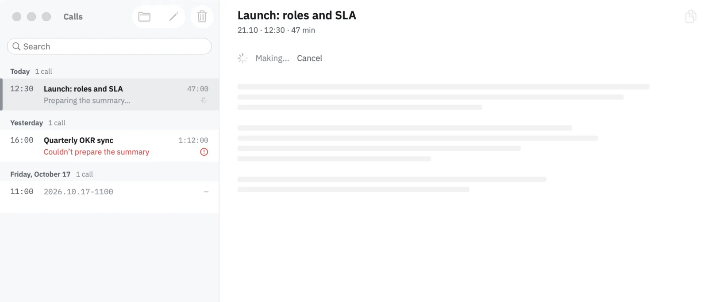
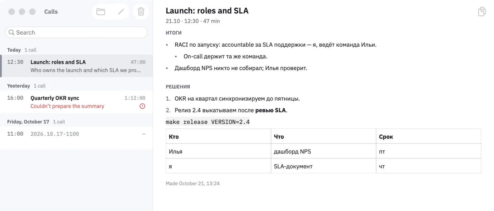
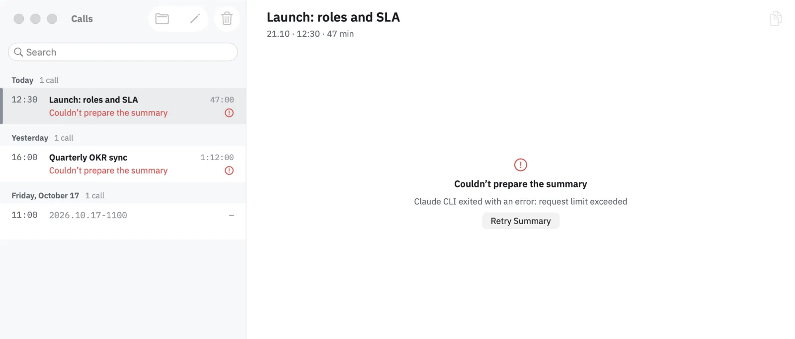

# Audelin: Call Notes You Can Cancel

Notes after a call are a slow request to a model. A slow request needs three answers in the window that shows it: is it running, can I stop it, and what happened when it failed?

[Audelin](https://github.com/igor1309/audelin) records both sides of a call and transcribes them on the Mac. After the call it can turn the transcript into notes. The calls window lists the calls on the left and shows the selected call's notes on the right, and that is where those answers now live.

## Notes on request

Automatic notes can be switched off. Then a call ends with a transcript and nothing else, and the row's menu, and the empty space beside the list, offer to make notes for it. Asking for them works even with automatic notes off: the request is the permission.

When a call ends with automatic notes on, the window shows its notes being made straight away, the same way as a request.

While the model works, the detail shows a skeleton of the notes with Cancel above it, and the row repeats the status in a line under its title. Finished notes say when they were made, so a reader can tell fresh notes from ones made before the transcript changed.

The interface follows the system language; the notes follow the call, so a Russian call gets Russian notes.

## Cancel and quit are different

Cancelling and quitting both stop the notes, but they mean different things.

Cancel is a decision. The job is dropped with no record, and the call goes back to having no notes, ready to be asked again.

Quitting the app is not a decision about the notes. The job stays on disk, and the next launch loads it as interrupted, with a way to run it again. A failed request is shown the same way: the error it got and a button to retry.

## One machine for one line of work

Behind the window, a call's notes pass through a line of stages: preparing the job, claiming it so a second copy of the app does not run it too, naming the speakers, asking the model, saving the result. Around that line sit recovery after a restart, retry, cancel and shutdown.

I am moving all of it into a single state machine: one value that holds every call's stage, and a pure function that takes an event and returns the next value and the work to do. A cancel is recorded as intent in that value; the running stage is discarded when its result arrives. Shutdown releases the running jobs so the next launch finds them interrupted.

The rule behind the change is simple to say: one line of work is one machine, and nothing outside it remembers where the work stands. The machine is built and tested stage by stage; the app moves onto it next.

The window itself is tested on a rehearsal build that opens it over folders of fixture calls with a fake summary runtime, so a script can make notes, cancel them and watch the result without a real call or a real model.

Where the summary runs, and who reads the transcript, is the subject of [Where the Transcript Goes](/articles/2026/2026-11-14-audelin-where-the-transcript-goes/).

The recording and live-transcript code, screenshots and build instructions are in [Audelin's public repository](https://github.com/igor1309/audelin).
