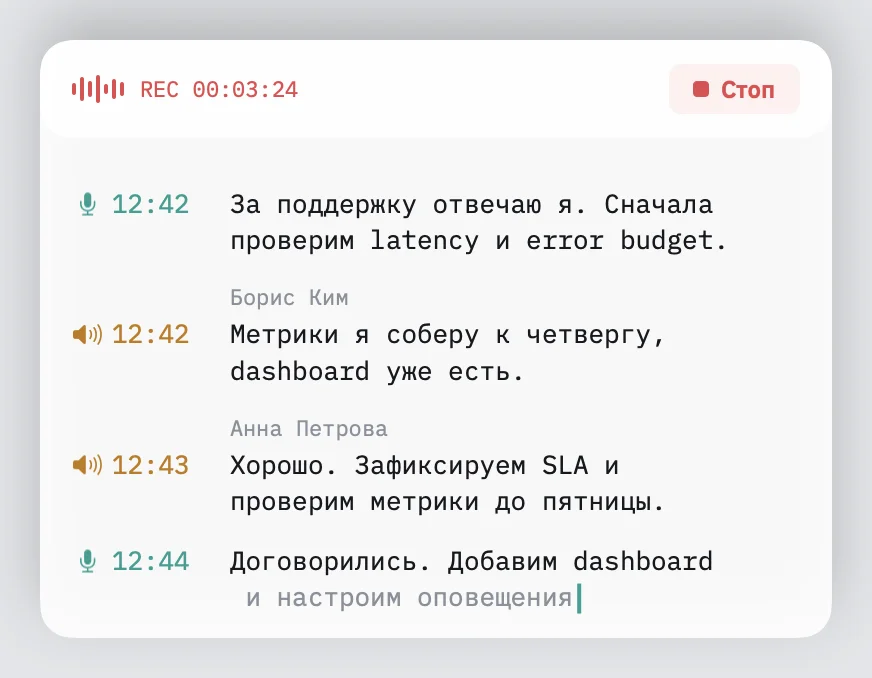

# Audelin: Who Is Speaking on the Call

During a call, the far side of [Audelin](https://github.com/igor1309/audelin)'s live transcript used to say only “Them”. The recording arrives as one mixed track, and telling its voices apart while they speak is a hard audio problem. The call page already knows the answer: Telemost draws a green border around whoever is talking. Audelin now reads that border.

The screenshot is the production panel rendered with a synthetic conversation and invented names; it records no audio.

## Why not the audio

Separating voices in a recording is called diarization. Audelin measured live diarization on group calls and found it not good enough: on the test set it got the number of speakers right in fewer than half the meetings. After the call a heavier model does much better, so that pass stays. But a name is most useful while the call is still running, and for that the page is a better witness than the waveform.

## From the page to the panel

A small Manifest V3 extension for Chrome and Yandex Browser runs on Telemost call pages. It finds the call frame, reads the participant tiles, tells your own tile from the others, and watches for the green speaking border. It relies on the page's test IDs and structure, not on translated labels or generated class names. Its tests run on saved Telemost pages: a gallery with one and with several remote people, speaker view, screen share, a pre-join screen and a page that is not a call. When two tiles share a name, nobody is marked speaking, because the extension cannot tell which one it is.

[diagram: sequence from Telemost page through the extension, the native host and the app socket to the panel]

Each change becomes an event with a sequence number and a browser timestamp, in one versioned message format that the extension and the app test against the same fixtures. The app rejects a message of an unknown version or shape.

The extension talks to the app through Chrome native messaging. The browser starts a small helper bundled inside Audelin and lets only the Audelin extension reach it; the helper relays to the running app over a local socket. Before the app accepts anything, the helper presents a secret from a file only the user can read, so no other local program can feed it names. While the app is away, the extension holds up to a thousand events and sends them in order when it reconnects. At launch the app registers the helper with both browsers and leaves alone any file it did not write.

## Two clocks

The browser and the app keep different time. Every five seconds the app pings the extension and records when the ping left, when the reply came back and the browser time inside it. The shortest of the last eight round trips gives the offset, and half its length is the uncertainty. A reconnect starts the estimate afresh. Events from before the recording began land at its start.

With times on the call clock, a remote row takes the name of the person shown speaking alone over most of it. Overlap, or nobody shown, leaves the row unnamed. The name is drawn in grey italics: a live guess, not a confirmed one.

## When the after-call pass hears no one

After the call, Audelin diarizes the recording and matches the voices against the same speaking timeline. Early on, a pass that found no remote voices erased the live names with nothing to replace them. Now such a pass keeps them. A nightly test rehearses a one-minute call fed with a fixture of extension events for two remote speakers, then reads the panel through the accessibility API and checks the names there and in the saved transcript.

Without the extension nothing breaks: recording and transcription go on, and the far side is simply unnamed.

The recorder and the live transcript are in [Audelin's public repository](https://github.com/igor1309/audelin).
