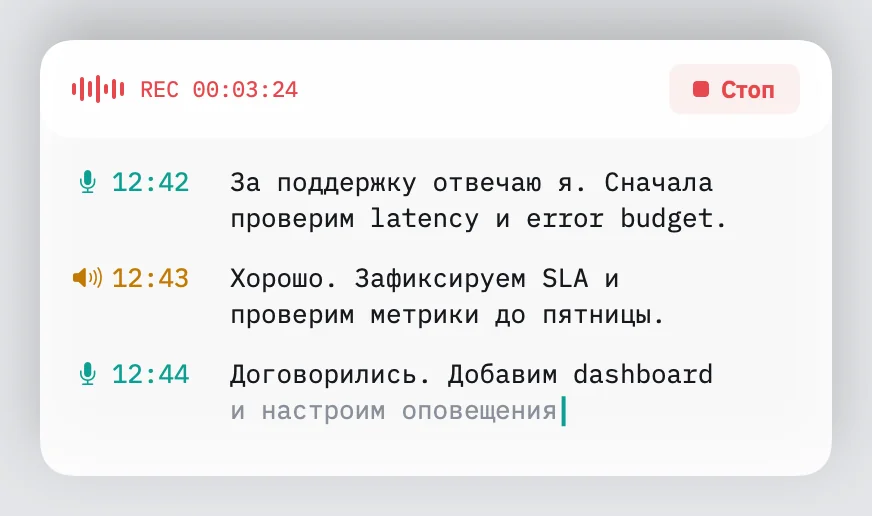
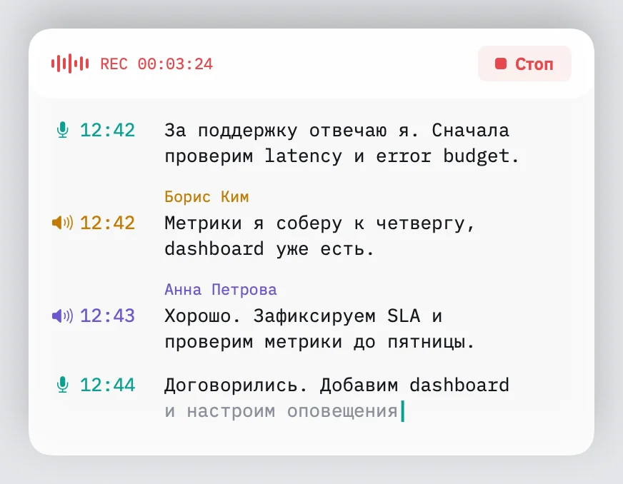
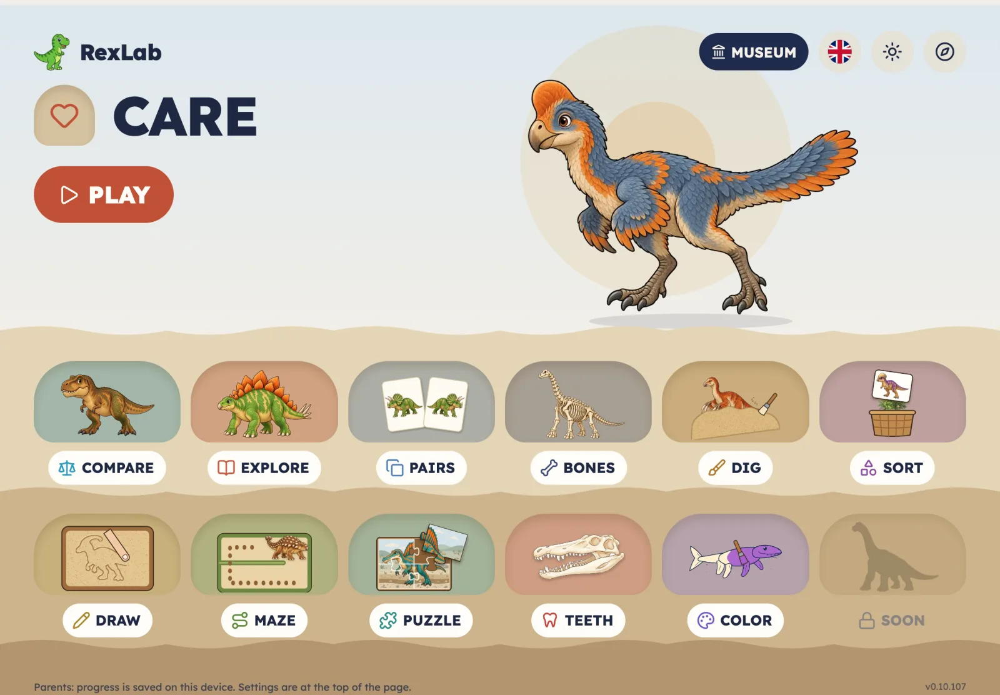
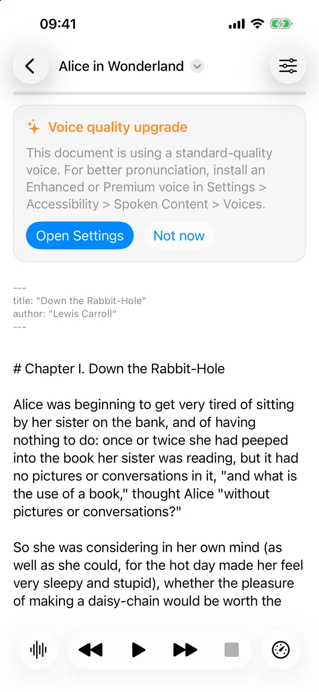
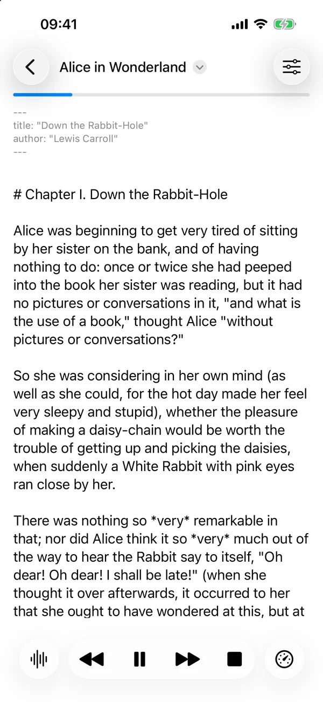
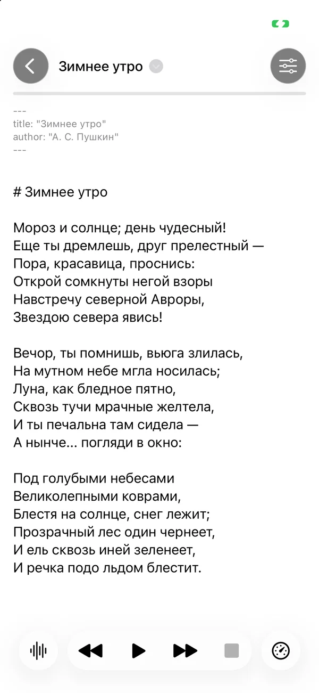
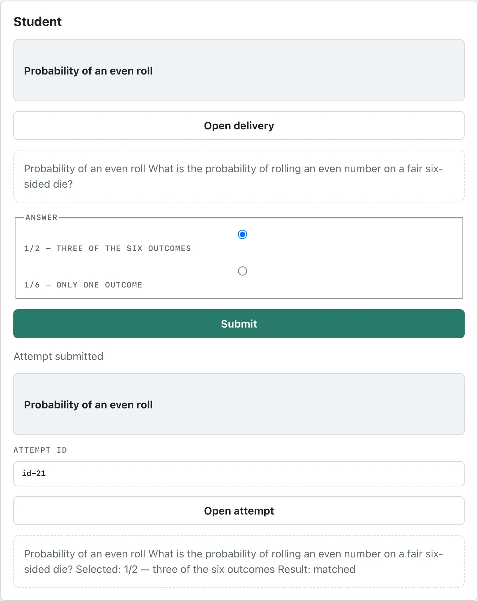

# Портфолио

## Сделано с AI-агентами

Эти проекты живут в моём приватном монорепозитории, где я делаю продукты с AI-агентами, которые работают по спецификациям и тестам. Каждый опубликован отдельным публичным репозиторием с кодом, тестами и README и проверен: он собирается и проходит тесты сам по себе, вне монорепозитория.

Статьи о проектах пока на английском.

### Audelin

***Swift***, ***SwiftUI***, ***Core Audio***, ***Swift Testing***

Нативная запись звонков для macOS с плавающей живой расшифровкой, текст которой можно выделять. Микрофон и звонок пишутся отдельными дорожками, звук и распознавание речи обрабатываются на самом Mac. Расширение для браузера в реальном времени подписывает имена собеседников в звонках Яндекс Телемоста.

[Скачать для macOS](https://github.com/igor1309/audelin/releases/latest) · [Исходный код](https://github.com/igor1309/audelin)

<picture><source media="(prefers-color-scheme: dark)" srcset="/images/portfolio/audelin/live-dark.webp"></picture>
<picture><source media="(prefers-color-scheme: dark)" srcset="/images/portfolio/audelin/speakers-live-dark.webp"></picture>

<cite>Audelin: живая расшифровка и имена собеседников из звонка в Телемосте.</cite>

 

### RexLab

***React***, ***TypeScript***, ***Vite***, ***Gherkin***, ***Vitest***

Обучающая игра про динозавров для детей 4–7 лет, сделанная для iPad в горизонтальной ориентации. Поведение сначала описано на Gherkin (87 feature-файлов) и проверяется 130+ файлами тестов Vitest.

[Играть](https://rexlab.enoa.ai) · [Исходный код](https://github.com/igor1309/rexlab)

<a href="https://rexlab.enoa.ai">
<picture>
<source media="(prefers-color-scheme: dark)" srcset="/images/portfolio/rexlab/home-dark.webp">

</picture>
</a>

<cite>Главный экран RexLab с играми про динозавров.</cite>

 

Статьи: [A Dinosaur Lab for Small Hands](/articles/2026/2026-08-01-rexlab-a-dinosaur-lab-for-small-hands/), [640 Scenarios Before Code](/articles/2026/2026-08-08-rexlab-640-scenarios-before-code/), [Tap Safety for Small Hands](/articles/2026/2026-08-15-rexlab-tap-safety-for-small-hands/).

### FolioTell

***SwiftUI***, ***AVSpeechSynthesizer***, ***Swift Testing***, ***Maestro***

Офлайн-приложение для iPhone, которое читает вслух файлы Markdown и обычный текст. SwiftUI поверх синтеза речи Apple; логика воспроизведения вынесена в отдельную библиотеку чистых редьюсеров и обработчиков эффектов, 196 тестов Swift Testing и сценарии Maestro на симуляторе.

[Исходный код](https://github.com/igor1309/foliotell)

<picture><source media="(prefers-color-scheme: dark)" srcset="/images/portfolio/foliotell/reader-dark.webp"></picture>
<picture><source media="(prefers-color-scheme: dark)" srcset="/images/portfolio/foliotell/playing-dark.webp"></picture>
<picture><source media="(prefers-color-scheme: dark)" srcset="/images/portfolio/foliotell/ru-dark.webp"></picture>

<cite>FolioTell: файл Markdown, чтение вслух и русское стихотворение.</cite>

 

Статьи: [An App That Reads Your Notes Aloud](/articles/2026/2026-08-22-foliotell-an-app-that-reads-your-notes-aloud/), [A Speech Synthesizer Behind a Reducer](/articles/2026/2026-08-29-foliotell-a-speech-synthesizer-behind-a-reducer/), [Where Am I in This Text?](/articles/2026/2026-09-05-foliotell-where-am-i-in-this-text/).

### Agister

***Go***

Консольный запуск работы AI-агентов, описанной в файлах настроек. Агенты, процессы и рабочие процессы — это настройки, которые складываются друг с другом; каждый запуск полностью разрешается до старта, укладывается в свои лимиты и бюджет и записывается целиком.

[Исходный код](https://github.com/igor1309/agister) · [Как выполняется запуск](/agister/run-architecture/) · [Как разрешаются настройки](/agister/settings-architecture/)

Статьи: [Agent Work as Settings, Not Code](/articles/2026/2026-09-12-agister-agent-work-as-settings-not-code/), [What a Run Leaves Behind](/articles/2026/2026-09-19-agister-what-a-run-leaves-behind/), [A Code Review With a Debate Inside](/articles/2026/2026-09-26-agister-a-code-review-with-a-debate-inside/).

### Agonara

***Node.js***, ***SQLite***

Среда для учебных программ, куда вы приходите со своим агентом. Куратор собирает программу из тем, понятий, материалов и проверок; студенты читают её, отвечают и видят, где у них пробелы. И те и другие направляют агента, которым уже пользуются, на один и тот же HTTP API, который обслуживает веб-интерфейсы `/learn` и `/admin`.

[Рабочий экземпляр](https://agonara.enoa.ai/learn) · [Исходный код](https://github.com/igor1309/agonara)

<picture><source media="(prefers-color-scheme: dark)" srcset="/images/portfolio/agonara/learn-quick-check-dark.webp"></picture>

<cite>Быстрая проверка в Agonara: студент отвечает на вопрос и видит результат.</cite>

 

Статьи: [A Learning Program Your Own Agent Can Work On](/articles/2026/2026-10-03-agonara-a-learning-program-your-own-agent-can-work-on/), [Drafts Are Not the Program](/articles/2026/2026-10-10-agonara-drafts-are-not-the-program/), [Grading Open Answers with a Model](/articles/2026/2026-10-17-agonara-grading-open-answers-with-a-model/).

## Ранние iOS-проекты

Hole Fill, CIFilterBrowser, Mobility, Covid-19 Observer и другие ранние приложения на SwiftUI описаны в [английской версии портфолио](/portfolio).
